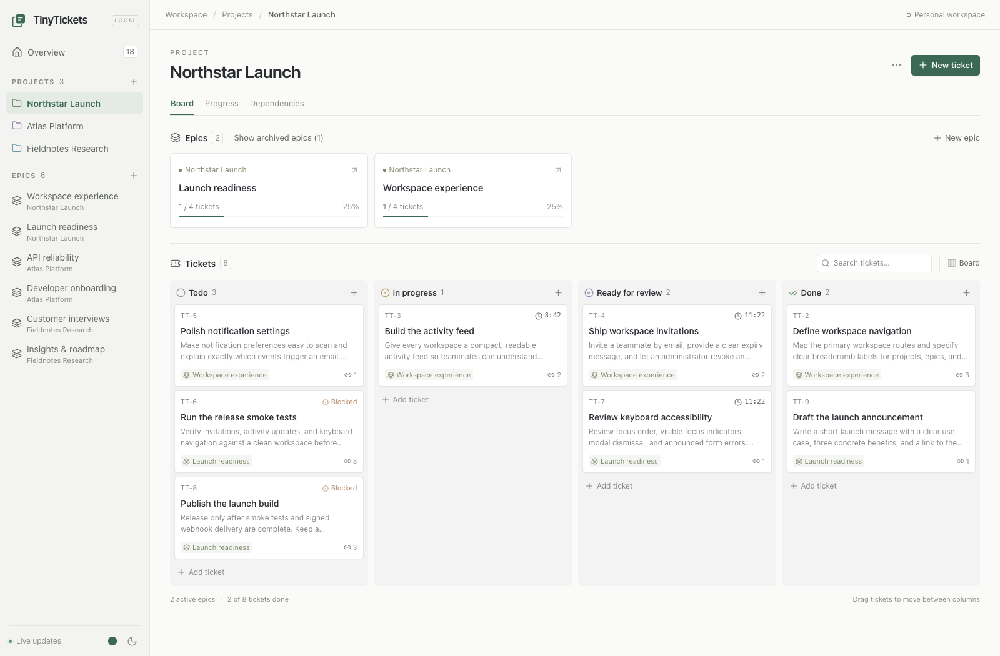

# TinyTickets

A tiny, local ticket management system for coding agents. Keep task specifications,
dependencies, progress, and review handoffs in one place, with a browser board for
you and API/MCP access for your agents.

One Go binary serves an embedded React frontend, a REST API, and an MCP server.
SQLite stores your workspace locally. No external services or CGO are required.



## Features

- **Organize work:** projects, epics, and tickets on a four-column board—Todo,
  In progress, Ready for review, and Done.
- **Coordinate agents:** ticket dependencies, ready-work discovery, and atomic
  claiming so cooperating agents do not start the same ready ticket.
- **Keep context:** Markdown and Mermaid descriptions, append-only work logs,
  and structured review handoffs.
- **See progress:** dependency maps, automatic status history, live column timers,
  and project execution timelines and metrics.
- **Stay in control:** live updates, reversible epic archiving, direct ticket links,
  keyboard/touch controls, responsive layouts, and light/dark themes.

## API and MCP

- **REST API:** manage projects, epics, tickets, and dependencies; claim ready work;
  read history and metrics; append notes and review handoffs.
- **MCP server:** the same workflow through local stdio or Streamable HTTP at
  `/mcp`, with setup guides for [OpenCode](docs/agents/opencode.md),
  [Claude Code](docs/agents/claude-code.md), [Codex](docs/agents/codex.md),
  and [Cursor](docs/agents/cursor.md).

See the [REST API reference](docs/reference.md#rest-api) and
[MCP reference](docs/reference.md#mcp) for details.

## Quick start

Requires Go 1.26+. The built frontend is included; Node is not needed to run it.
From the repository root:

```sh
go build -o tinytickets .
./tinytickets
```

Open **http://127.0.0.1:8080**. Your database defaults to
`~/.tinytickets/tinytickets.db`. Use `--db` to select another file or `--help` for
all options.

TinyTickets is a **single-user local application without authentication**. Keep it
on trusted local interfaces and connect only trusted agents.
See [environment and security guidance](docs/environment.md) before remote use.

## Documentation

- [Documentation index and agent setup](docs/README.md)
- [Let an agent set up TinyTickets](docs/setup-for-agents.md)
- [Repository work-tracking policy template](docs/templates/repository-policy.md)
- [Application behavior, execution metrics, and API reference](docs/reference.md)
- [Development and tests](docs/reference.md#development) ·
  [Frontend guide](web/README.md)
- [Documentation website: build and publishing](site/README.md)
