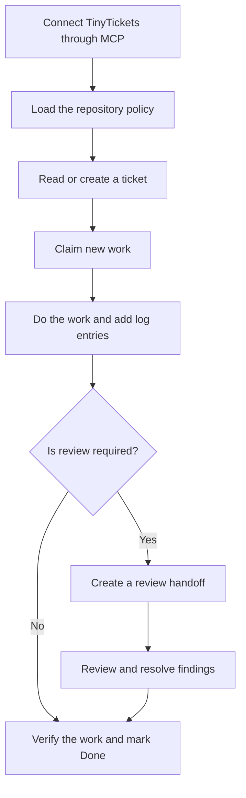

# Choose an approach

Use MCP and a repository policy first.
Add a skill when the agent needs more procedure detail.
Add hooks only when you need checks outside the model's instructions.

## Compare the approaches

| Approach | Function | Limit |
| --- | --- | --- |
| MCP server instructions | Explain tools and shared workflow rules | A client can omit or limit these instructions |
| Repository policy | Tell the agent when it must track work | The model can fail to follow the policy |
| Skill | Give a reusable procedure when needed | The agent might not load it |
| Hooks or plugin | Check actions at client-defined events | Checks cover only the events and tools that the client exposes |
| Managed client settings | Distribute approved settings across a team | Availability depends on the client and plan |

MCP access alone does not require an agent to create tickets.
A skill alone does not require work tracking either.
Keep the essential rules in an instruction file that loads for every session.

The diagram shows the normal sequence. Follow the repository's review policy.
Do not mark work Done only because a session ends.

## Select the scope

- Use a project connection when only one repository needs TinyTickets.
- Use a user connection when you want access from many repositories.
- Keep the repository-to-project mapping in each repository's policy.
- Use one ticket for one meaningful result. Do not create a ticket per tool call.
- Decide if questions and read-only investigations need tickets.
  The supplied template requires tickets for changes, not ordinary questions.

A global MCP connection does not select a TinyTickets project.
Resolve the project through `get_workspace` before you create work.
Do not guess database IDs. Confirm ambiguous project names with the user.

## Understand the limits

`claim_ticket` and `claim_next_ticket` atomically start ready work.
Ready work is Todo, belongs to an unfinished and unarchived epic, and has no
unfinished blocking ticket. Blockers can belong to other projects.

A claim is not an ownership lock. There is no owner lease or automatic return
to Todo. Ordinary status updates and board moves can bypass claim eligibility.
Return abandoned work to Todo explicitly, after you confirm that work has stopped.

TinyTickets has no built-in customer agent installer or tracking-enforcement
plugin. Hook designs in these docs require a separate implementation.
There are no `tinytickets init` or `tinytickets doctor` commands.

## Select an outage policy

**Stop mode:** stop implementation changes if tracking is unavailable.
Allow read-only diagnosis and setup repair.

**Continue mode:** report the outage and keep a short local work summary.
Add that summary to TinyTickets when the connection returns.
Do not invent past claim times or test results.

The policy template uses stop mode. Let the user approve a temporary exception.
Neither mode is a security control.

Next: [Prepare the environment](environment.md).
