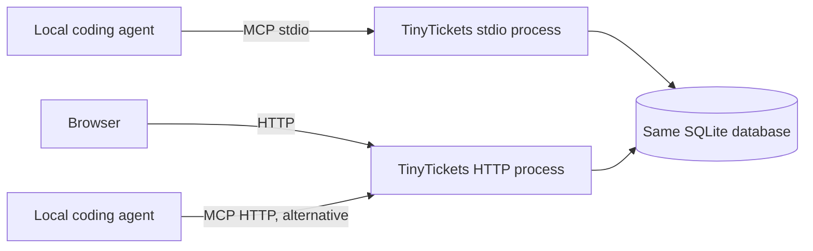

# Prepare the environment

## 1. Select a trusted binary

Use an existing trusted TinyTickets binary, or build it from this repository.
Do not replace an existing binary without approval.
To build, install Go 1.26 or later. Then run this command in the TinyTickets source directory:

```sh
go build -o tinytickets .
```

The frontend is included in the source tree. This build does not need Node.
Keep the binary at a stable location. Use its absolute path in client settings.
On Windows, use the executable's `.exe` file name.

In the examples, replace `/absolute/path/to/tinytickets` with the binary path.
Replace `/absolute/path/to/tickets.db` with the selected database path.
These are placeholders, not usable default paths.
Commands use a POSIX shell. Adapt shell quoting for your operating system.

## 2. Select the database

The default database is `~/.tinytickets/tinytickets.db`.
An explicit `--db` path prevents different clients from using different files
by accident. A missing database is created automatically.
Confirm the path before the first connection.

Use the same absolute database path for the browser server and all stdio clients
that must share work. Use separate databases for environments that must be isolated.
Do not commit databases, SQLite sidecar files, or binaries.

**Warning:** TinyTickets is a single-user application without authentication.
An MCP client has full access to the selected database.
A project name in an instruction file does not restrict database access.
Connect only trusted agents.

## 3. Select a transport

### Stdio: recommended for local agents

The agent starts this process:

```sh
/absolute/path/to/tinytickets --mcp-stdio --db /absolute/path/to/tickets.db
```

Put the command in the client's MCP settings. Do not start it as a background
HTTP server. Stdio mode has no browser interface.
For browser access, start a separate HTTP process with the same database path.

### Streamable HTTP: use an existing local server

Start the server in a separate terminal:

```sh
/absolute/path/to/tinytickets --addr 127.0.0.1:8080 --db /absolute/path/to/tickets.db
```

Keep it running. Open `http://127.0.0.1:8080` for the board.
Use `http://127.0.0.1:8080/mcp` for MCP. Do not use `/api/events` as an MCP endpoint.
That route serves browser update events, not the MCP SSE transport.



The diagram shows two transport options. Configure only one TinyTickets
connection per agent unless you need separate databases.

### Remote or container environments

`127.0.0.1` identifies the machine or container where the client runs.
It does not identify your laptop from a cloud agent.
Local stdio paths must exist in the agent's execution environment.

Do not expose TinyTickets on an untrusted network.
Use an authenticated reverse proxy and approved network controls for remote HTTP.
Check the client's remote transport support before setup.
Do not add invented API keys or OAuth settings to the local server.

## 4. Preserve existing settings

Read the active client settings before changes.
Check for a TinyTickets entry at both project and user scope.
Merge only the required entry. Preserve other servers, policies, and permissions.
Do not add a duplicate connection to repair a broken one.

Keep personal absolute paths out of shared configuration when they do not apply
to other users. A project-scoped file can still contain machine-specific paths.
Review it before a commit.

Next: select your agent from the [documentation index](README.md).
