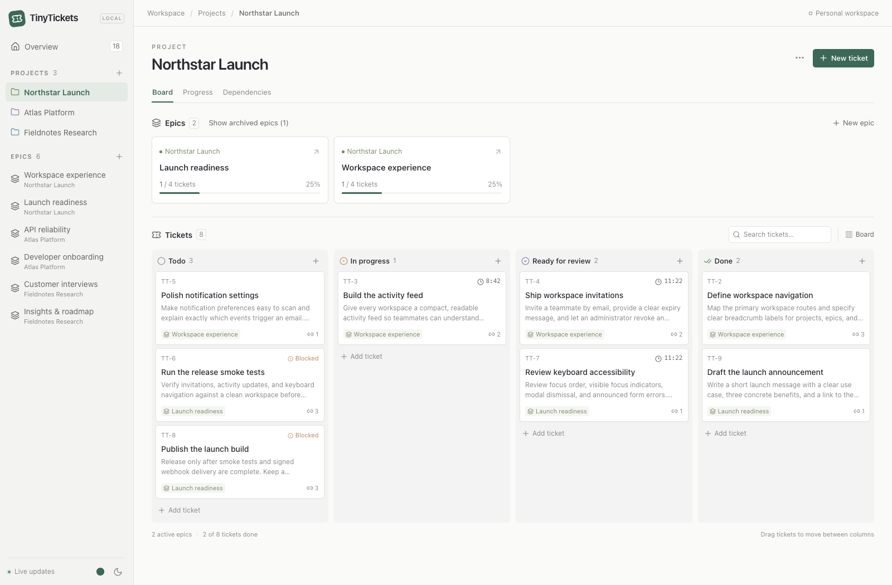
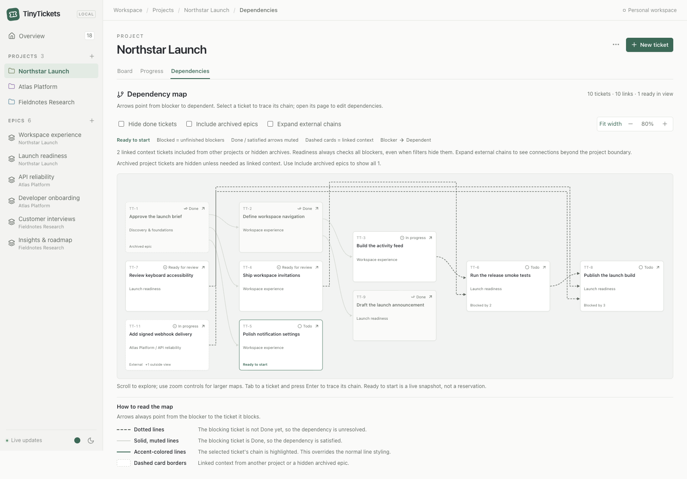
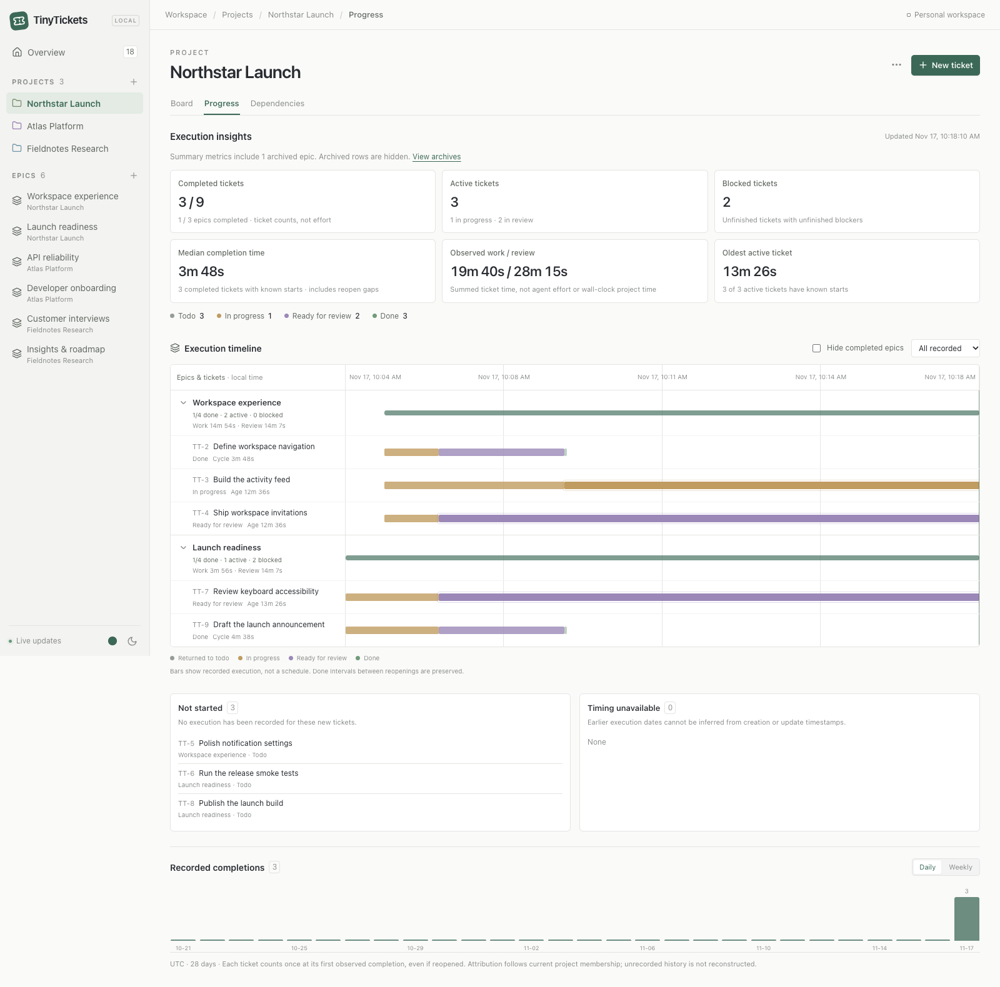

# TinyTickets demo gallery

Screenshots captured from the running demo at **http://127.0.0.1:8080** on
2026-11-17. Open the PNGs at their original size for readable text.

## Demo workspace

| Project | Scenario | Live board |
| --- | --- | --- |
| Northstar Launch | Product delivery, launch blockers, an archived foundation, and a cross-project prerequisite | [Open](http://127.0.0.1:8080/#project/1) |
| Atlas Platform | API reliability, signed webhooks, developer onboarding, and review work | [Open](http://127.0.0.1:8080/#project/2) |
| Fieldnotes Research | Customer interviews, research synthesis, and roadmap dependencies | [Open](http://127.0.0.1:8080/#project/3) |

The demo contains **7 epics, 24 tickets, and 20 dependency links**. At capture time,
9 tickets were Todo, 5 In progress, 4 Ready for review, and 6 Done. One completed
epic is archived; its tickets and history are preserved.

There are **37 work-log entries**, including **8 structured review handoffs**, and
**54 recorded creation/status events**. Four Todo tickets are ready to claim; the
remaining Todo work has unfinished blockers. The activity-feed ticket was returned
from review to In progress, illustrating retained review context, separate work
intervals, and a restarted current-column timer.

All projects, people, delivery notes, and verification narratives are **fictional
demo content**, not claims about real product delivery. The activity itself was
created through the application's MCP API with genuine timestamps: no direct
database edits, backdated events, mocked responses, or altered screenshot data.
Execution charts therefore cover the actual minutes spent preparing the demo,
not invented days of work. The independent development workspace was preserved.

## Highlights

### Project board

### Dependency map

### Execution insights

## Complete screenshot index

| Screenshot | What it shows |
| --- | --- |
| [01 · Workspace overview](01-workspace-overview.png) | Active epics across all three projects and the combined ticket board |
| [02 · Projects](02-projects.png) | Three project cards and their visible epic counts |
| [03 · Project board](03-project-board.png) | Todo, In progress, Ready for review, Done, blocked badges, and live timers |
| [04 · Platform board, dark](04-platform-board-dark.png) | Atlas Platform in the dark Slate palette |
| [05 · Epic board](05-epic-board.png) | Work scoped to Workspace experience |
| [06 · Full ticket](06-ticket-markdown-mermaid.png) | Markdown, checklist, Mermaid sequence diagram, table, details, dependencies, and chronological updates |
| [07 · Work log and review handoff](07-work-log-review-handoff.png) | A focused view of append-only notes, verification, references, and reviewer guidance |
| [08 · Dependency map](08-dependency-map.png) | Satisfied/unresolved arrows, ready work, archived prerequisites, and cross-project context |
| [09 · Selected dependency chain, dark](09-dependency-chain-dark.png) | Launch ancestry highlighted with the selected-ticket inspector |
| [10 · Execution insights](10-execution-insights.png) | Metrics, actual work/review intervals, not-started work, and recorded completion activity |
| [11 · Platform progress, dark](11-platform-progress-dark.png) | Ongoing and completed platform work with observed timing |
| [12 · Epics and archives](12-epics-and-archives.png) | Global epic discovery with a separate archived-work section |
| [13 · Project archive toggle](13-project-archives-toggle.png) | Archived cards included in the combined project epic list |
| [14 · Archived epic](14-archived-epic.png) | Direct access to preserved archived work and restoration controls |
| [15 · Ticket editor](15-ticket-editor.png) | Editing title/description, status/epic assignment, and dependency controls |
| [16 · Safe force-delete preview](16-safe-force-delete.png) | Explicit opt-in, aggregate deletion impact, and the external-dependency warning; **nothing was deleted** |
| [17 · Appearance controls, dark](17-appearance-controls-dark.png) | Theme and accent-color preferences |
| [18 · Mobile ticket](18-mobile-ticket.png) | Responsive rich content, work log, and stacked ticket details |
| [19 · Mobile review, dark](19-mobile-review-dark.png) | Review handoff and details on a narrow screen in dark mode |

Desktop captures use a **1600 × 1050** viewport; mobile captures use **390 × 844**,
at device scale 1 with UTC timestamps. Most PNGs capture the entire scrollable page;
the editor, deletion confirmation, and appearance popup use viewport captures.
Screenshot 07 is an element capture of the work-log section. The map uses the
application's own zoom controls to keep the graph visible. Text, themes, layouts,
and diagram rendering are from the application, without injected presentation CSS.

[`manifest.json`](manifest.json) records individual URLs, viewport sizes, themes,
capture modes, counts, and capture time. No browser exceptions or HTTP 5xx responses
were observed during the final capture pass. Live URLs and resource IDs refer to
this demo instance; screenshot files remain usable independently of it.
